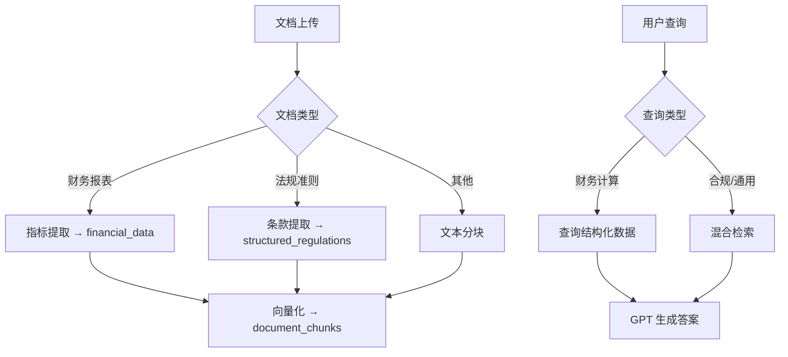

# Project Goodman · AI 智能财务助手

> 让财务工作流全自动、零压力

[在线体验](https://goodman.antelacus.com) · [License: AGPL-3.0](https://www.gnu.org/licenses/agpl-3.0.html)

---

## 功能概览

| 模块 | 描述 |
|------|------|
| **智能对话** | 统一 AI 界面，自动理解意图并调用工具（SSE 流式响应、多轮对话） |
| **快捷工具** | 独立快速操作（文档信息提取） |
| **文档管理** | 上传文档的预览、编辑、删除 |

### 核心能力

| 能力 | 描述 |
|------|------|
| **财务指标分析** | 22 个预设函数：流动比率、ROE、杜邦分析等 |
| **财务合规指导** | 混合检索法规库（关键词 + 向量） |
| **文档信息提取** | 从 PDF/图片/Excel 提取结构化数据 |

---

## 技术栈

| 类别 | 选型 |
|------|------|
| 前端 | Next.js 15 · React 19 · Tailwind CSS 4 |
| 数据库 | Supabase (PostgreSQL + pgvector) |
| AI | OpenAI GPT-4o · text-embedding-3-small |
| 部署 | VPS + Docker + nginx (Cloudflare CDN) |

---

## 架构概览



---

## 目录结构

```
project-goodman/
├── src/
│   ├── app/              # Next.js 路由 (landing, workspace, api)
│   ├── components/       # React 组件 (chat, layout, documents)
│   └── lib/              # 业务逻辑 (database, documents, financial, workflows)
├── supabase/migrations/  # 数据库迁移
├── docs/                 # 开发文档
└── tests/                # 测试
```

---

## 文档索引

| 文档 | 用途 |
|------|------|
| [docs/PRODUCT_ROADMAP.md](docs/PRODUCT_ROADMAP.md) | 产品路线图、版本规划 |
| [CHANGELOG.md](CHANGELOG.md) | 版本历史 |
| [CLAUDE.md](CLAUDE.md) | AI 开发配置 |
| [docs/TECHNICAL_DEBT.md](docs/TECHNICAL_DEBT.md) | 技术债务登记 |

---

## License

[AGPL-3.0](https://www.gnu.org/licenses/agpl-3.0.html)
