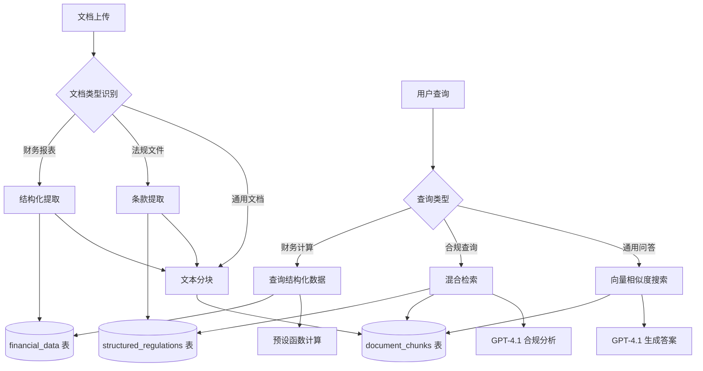

# 

# Project Goodman · AI 智能财务助手

> 让财务工作流全自动、零压力

[在线体验 Demo](https://goodman.antelacus.com)｜[License: AGPL-3.0](https://www.gnu.org/licenses/agpl-3.0.html)

---

## 功能概览

| 模块 | 描述 | 典型场景 |
|------|------|-----------|
| **智能首页** | AI 对话式导航，理解用户意图并推荐合适的功能模块 | 新用户引导、快速定位功能 |
| **财务信息提取** | 上传 PDF 文档，AI 自动抽取关键信息并生成结构化结果<br/>**管理员模式**：将文档上传至数据库并进行结构化存储 | 合同、发票、报表 |
| **财务指标分析** | 基于数据库文档，AI 对话式计算财务指标<br/>**14+ 预设函数**：流动比率、ROE、资产负债率等<br/>**自定义查询**：支持任意指标提取与增长率计算（如"销售现金流增长"） | 财报分析、趋势预测 |
| **财务合规指导** | 结合法规+业务文档，判断处理是否合规并给出建议<br/>**混合检索**：关键词匹配 + 向量相似度<br/>**智能计算**：支持上传合同/文档（自动向量化），自动提取数据并进行合规性测算 | 税务筹划、风险识别 |

<details>
<summary>📸 项目截图（点击展开）</summary>

| 首页 | 信息提取 | 指标分析 | 合规指导 |
|------|----------|----------|----------|
|  |  |  |  |

---

## 管理员模式配置（可选）

管理员模式允许您直接上传文档到数据库并进行结构化存储，包括财务报表和法规文件的深度解析。

### 配置步骤

1. **设置管理员密码**：在 `.env.local` 中添加：

   ```bash
   ADMIN_PASSWORD=your_secure_password_here
   ```

2. **激活管理员模式**：
   - 访问 **财务信息提取** 页面 (`/data-extract`)
   - 在页面标题处的 **📄** 图标上 **三击**（triple-click）
   - 输入管理员密码解锁

3. **上传文档到数据库**：
   - 选择文档类型（资产负债表、利润表、现金流量表、法规文件等）
   - 填写年份和期间（针对财务报表）
   - 点击「上传到数据库」
   - AI 将自动进行结构化提取并存储

### 支持的文档类型

| 文档类型 | 结构化存储 | 典型应用 |
|---------|-----------|---------|
| **资产负债表** | 提取全部科目 → `financial_data` 表 | 财务指标计算 |
| **利润表** | 提取收入/成本/利润 → `financial_data` 表 | 盈利能力分析 |
| **现金流量表** | 提取现金流数据 → `financial_data` 表 | 流动性分析 |
| **法规文件** | 逐条提取 → `structured_regulations` 表 | 合规指导查询 |
| **合同/发票** | 提取关键字段 → 向量存储 | 通用信息提取 |

---

## 亮点特性

- 🧠 **GPT-4.1 + Function Calling**：智能路由、意图理解、精准计算
- 🗄️ **双重存储架构**：结构化数据（PostgreSQL）+ 向量嵌入（pgvector），兼顾精度与语义
- 🔢 **14+ 预设财务函数**：流动比率、ROE、资产负债率等开箱即用，可扩展
- 🔍 **混合检索技术**：关键词匹配 + 向量相似度，合规查询更准确
- 📊 **多维信心评分**：6 大指标综合评估，低信心自动抑制，避免误导
- 🔐 **管理员模式**：安全的文档上传与结构化存储（bcrypt 加密，session 管理）
- ⚡ **实时预览 & 复制**：分析结果一键复制，公式高亮可点击校验
- 🔗 **可追溯性与引用**：点击引用可查看源文档，点击计算步骤可查看公式解释
- 💾 **数据持久化**：用户上传文档自动向量化并持久化存储
- 🧩 **模块化架构**：易于接入自有 LLM / Embedding 服务
- 📱 **响应式 UI**：Tailwind CSS 4 打造现代财务应用体验
- 🚀 **Serverless 优先**：完全兼容 Vercel 免费部署

---

## 技术栈

| 类别 | 选型 |
|------|------|
| 前端框架 | Next.js 15 · React 19 |
| 状态管理 | Zustand |
| 样式 | Tailwind CSS 4 |
| 数据库 | Supabase (PostgreSQL + pgvector) |
| AI 服务 | OpenAI GPT-4.1 · text-embedding-3-small |
| 文档处理 | pdfjs-dist · xlsx |
| 安全 | bcryptjs（密码哈希）· Session 管理 |
| 验证 | Zod（Schema 验证） |
| 计算引擎 | expr-eval（安全公式求值） |
| 部署 | Vercel Serverless |

---

## 架构概览

### 双重存储架构

Project Goodman 采用 **结构化存储 + 向量存储** 的双重架构，兼顾精确计算与语义理解：



### 数据库架构

#### 核心表结构

- **documents** - 文档元数据（知识型/业务型，年份/期间）
- **document_chunks** - 文本分块 + 向量嵌入 (1536维)
- **financial_data** - 结构化财务指标（科目、金额、单位）
- **structured_regulations** - 结构化法规条款（条文号、内容、关键词）
- **preset_functions** - 预设计算函数定义（15+ 财务指标）
- **calculation_history** - 计算审计日志
- **admin_config** - 系统配置

#### 核心功能

- **match_documents()** - pgvector 余弦相似度搜索
- **search_financial_data()** - 结构化财务数据查询
- **search_regulations_hybrid()** - 混合检索（关键词 + 语义）
- **executeFunction()** - 预设函数安全执行引擎
- **buildConfidence()** - 多维信心评分（6 大指标）

---

## 目录结构摘要

```
project-goodman/
├── src/
│   ├── app/                         # Next.js 应用路由
│   │   ├── api/                    # API 路由
│   │   │   ├── admin/              # 管理员端点（密码验证、文档上传）
│   │   │   ├── landing-chat/       # 首页对话路由
│   │   │   ├── financial-analysis-v2/ # 财务分析 v2（预设函数）
│   │   │   ├── guidance-chat-v2/   # 合规指导 v2（混合检索）
│   │   │   ├── preset-functions/   # 预设函数列表
│   │   │   └── ...                 # 其他 API 路由
│   │   ├── page.tsx                # 智能首页（对话式导航）
│   │   ├── data-extract/           # 信息提取模块
│   │   ├── financial-analysis/     # 财务分析模块
│   │   └── guidance-chat/          # 合规指导模块
│   ├── components/                 # React 组件
│   │   ├── AdminPasswordTrigger.tsx # 管理员密码弹窗
│   │   ├── Navbar.tsx              # 导航栏（带路由高亮）
│   │   └── ...                     # 其他 UI 组件
│   ├── lib/                        # 工具函数库
│   │   ├── prompts/                # Prompt 模板
│   │   │   ├── landing-page.txt    # 首页路由 prompt
│   │   │   ├── financial-analysis-v2.txt
│   │   │   └── guidance-chat-v2.txt
│   │   ├── preset-functions.ts     # 15+ 预设财务函数
│   │   ├── structured-extraction.ts # 结构化提取引擎
│   │   ├── confidence-scoring.ts   # 信心评分系统
│   │   ├── admin-auth.ts           # 管理员认证
│   │   └── ...                     # 其他工具
│   └── store/                      # Zustand 状态管理
├── supabase/
│   ├── migrations/                 # 数据库迁移文件
│   │   ├── 20250107000000_init_vector_database.sql
│   │   ├── 20250113000000_add_structured_storage.sql
│   │   ├── 20250113000001_modify_existing_tables.sql
│   │   └── 20250113000002_add_database_functions.sql
│   └── README.md                   # Supabase 设置指南
├── scripts/
│   ├── migrate-to-supabase.ts      # 数据迁移脚本
│   └── preprocessor.py             # 文档预处理工具
├── data/
│   └── documents/                  # 知识库文档（待迁移）
└── public/                         # 静态资源
```

---

## Roadmap

### V1 开发（已完成）

- [x] 初版功能模块开发
- [x] UI 设计
- [x] 首页设计
- [x] 文档编写
- [x] 在线部署

### V2 开发（进行中）

- [x] 功能模块升级

### V3 开发（规划中）

- [ ] 迁移至 LangGraph 框架
- [ ] 自定义指标公式编辑器
- [ ] 多模型适配（Claude, Gemini, 国产大模型）
- [ ] 企业 SSO & RBAC
- [ ] 团队协作 & 审计追踪
- [ ] 高级可视化（图表、趋势分析）

---

## 操作指南

### 添加新的知识库文档

**通过管理员模式上传**

- 启用管理员模式（配置 `ADMIN_PASSWORD`）
- 访问财务信息提取页面，三击 📄 图标解锁
- 选择文档类型并上传
- AI 自动进行结构化提取并存储到数据库

### 添加预设财务函数

Project Goodman 内置 **14+ 预设财务计算函数**，覆盖 4 大类别：

| 类别 | 函数 |
|------|------|
| **流动性比率** | 流动比率、速动比率、现金比率 |
| **偿债能力比率** | 资产负债率、产权比率、权益乘数 |
| **盈利能力比率** | 销售毛利率、销售净利率、ROA、ROE |
| **营运能力比率** | 总资产周转率、存货周转率、应收账款周转率、营运资本周转率 |

所有函数定义在 `src/lib/preset-functions.ts`，可通过 `/api/preset-functions` 查询列表。

### 本地开发

```bash
npm run dev        # 启动开发服务器
npm run build      # 构建生产版本
npm run start      # 启动生产服务器
npm run lint       # ESLint 检查
```

### 测试

所有测试文件位于项目根目录，以 `test-*.ts` 命名：

```bash
# 运行特定测试
npx tsx test-task25-admin-auth-flow.ts
npx tsx test-task27-financial-calculations.ts
npx tsx test-financial-analysis-v2.ts
npx tsx test-task28-focused.ts
npx tsx src/scripts/test-financial-validation.ts

# 运行所有测试
for file in test-*.ts; do npx tsx "$file"; done
```

### 重要模式

- **API 路由**: 处理所有后端逻辑，包括 LLM 调用和数据库操作
- **客户端组件**: 使用 `'use client'` 指令，处理用户交互
- **服务器组件**: 默认组件，处理数据获取和初始渲染
- **错误处理**: 使用 `try-catch` 块，统一错误响应格式
- **提示词模板**: 所有模板存储在 `src/lib/prompts/` 目录中（不支持环境变量覆盖）

---

## 重要考量

- **双重存储**: 文档存储在结构化表（快速查询）和向量块（语义搜索）中。相应地平衡存储使用。
- **管理员安全**: 管理员密码使用简单的字符串比较 (MVP)。对于生产环境，实施 bcrypt 哈希并考虑使用 Redis 进行会话存储。
- **置信度阈值**: 着陆页 (70%), 财务分析 (85%), 指导 (75%)。根据实际准确性进行调整。
- **预设函数**: 14 个函数涵盖常用比率。通过 `preset-functions.ts` 按需添加更多。
- **结构化提取**: LLM 驱动的资产负债表和法规提取。通过抽查验证准确性。
- **混合搜索**: 关键词与向量的权重为 50/50。根据用户反馈调整权重。

- **API 成本**: 着陆页使用 GPT-4o-mini (更便宜)。财务/指导使用 GPT-4.1 + 嵌入。密切监控 OpenAI 使用情况。
- **数据库限制**: Supabase 免费层有 500MB 存储，5GB 带宽/月。阶段 3 结构化表增加了存储使用。通过仪表板监控。
- **向量索引**: 批量数据插入后创建 IVFFlat 索引以获得更好的性能
- **连接池**: Supabase 自动为 Serverless 函数处理此问题
- **持久性**: 所有文档现在都持久化在 Supabase 中 (刷新后无数据丢失)
- **速率限制**: `src/lib/rateLimit.ts` 中的简单内存速率限制。管理员端点限制为 5 req/min。生产环境考虑使用 Redis。
- **安全**: 验证所有文件上传。数据库上传需要管理员认证。多租户场景使用 Supabase RLS (行级安全)。
- **自动暂停**: Supabase 免费层在 7 天不活动后自动暂停 (请求时即时唤醒)
- **计算准确性**: 预设函数确保 100% 计算准确性。始终验证结果是否符合预期公式。
- **LLM 模型**: 着陆页 (GPT-4o-mini), 财务分析与指导 (GPT-4.1)。根据成本/性能权衡调整模型。

---

## License

[AGPL-3.0](https://www.gnu.org/licenses/agpl-3.0.html)
