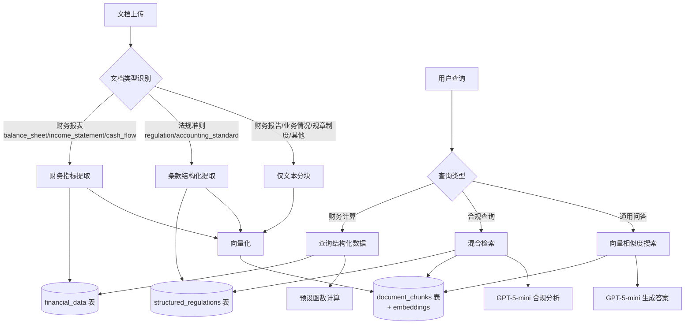

# 

# Project Goodman · AI 智能财务助手

> 让财务工作流全自动、零压力

<!--
文档用途: 项目的公开介绍文档。解释项目是什么、如何使用、为什么存在。目标读者是用户和新开发者。

| 读者 | 更新频率 | 相关文档 |
|------|----------|----------|
| 用户、新开发者 | 功能/配置变更时 | CHANGELOG (版本历史), DESIGN (架构) |
-->

[在线体验 Demo](https://goodman.antelacus.com)｜[License: AGPL-3.0](https://www.gnu.org/licenses/agpl-3.0.html)

---

## 功能概览

| 模块 | 描述 | 典型场景 |
|------|------|-----------|
| **智能首页** | AI 对话式导航，理解用户意图并推荐合适的功能模块 | 新用户引导、快速定位功能 |
| **财务信息提取** | 上传文档（PDF、图片、Excel），AI 自动抽取关键信息并生成结构化结果 | 合同、发票、报表 |
| **文档管理** | 管理已上传的文档，支持预览、编辑属性、删除<br/>**管理员模式**：将文档上传至数据库并进行结构化存储 | 知识库管理 |
| **财务指标分析** | 基于数据库文档，AI 对话式计算财务指标<br/>**22 个预设函数**：流动比率、ROE、资产负债率、杜邦分析等<br/>**自定义查询**：支持任意指标提取与增长率计算 | 财报分析、趋势预测 |
| **财务合规指导** | 结合法规+业务文档，判断处理是否合规并给出建议<br/>**混合检索**：关键词匹配 + 向量相似度<br/>**智能计算**：支持上传文档（自动向量化），自动提取数据并进行合规性测算 | 税务筹划、风险识别 |

<details>
<summary>📸 项目截图（点击展开）</summary>

| 首页 | 信息提取 | 指标分析 | 合规指导 |
|------|----------|----------|----------|
|  |  |  |  |

</details>

---

## 管理员模式配置（可选）

管理员模式允许您直接上传文档到数据库并进行结构化存储，包括财务报表和法规文件的深度解析。

### 配置步骤

1. **设置管理员密码**：在 `.env.local` 中添加：

   ```bash
   ADMIN_PASSWORD=your_secure_password_here
   ```

2. **激活管理员模式**：
   - 访问 **文档管理** 页面 (`/documents`)
   - 在页面标题处的 **📁** 图标上 **三击**（triple-click）
   - 输入管理员密码解锁

3. **上传文档到数据库**：
   - 选择文档类型（见下表分类）
   - 填写年份和期间（针对财务报表类）
   - 点击「上传到数据库」
   - 系统自动执行类型对应的处理流程
   - 原始文件同时保存到 Supabase Storage，支持预览

### 支持的文档类型与处理流程

数据库文档分为 4 大类，每类有不同的处理方式：

| 主类别 | 文档类型 (doc_type) | 处理方式 | 说明 |
|--------|---------------------|----------|------|
| **财务报表** | `balance_sheet` 资产负债表 | 财务指标提取 + 向量化 | 提取科目 → `financial_data` 表，需指定年份/期间 |
| | `income_statement` 利润表 | 财务指标提取 + 向量化 | 提取收入/成本/利润 → `financial_data` 表 |
| | `cash_flow` 现金流量表 | 财务指标提取 + 向量化 | 提取现金流数据 → `financial_data` 表 |
| | `financial_report` 财务报告 | 仅向量化 | 仅支持 PDF，用于语义搜索，需指定年份/期间 |
| **法规准则** | `regulation` 法律法规 | 条款结构化 + 向量化 | 逐条提取（"第X条"格式）→ `structured_regulations` 表 |
| | `accounting_standard` 会计准则 | 条款结构化 + 向量化 | 逐条提取 → `structured_regulations` 表 |
| | `policy` 规章制度 | 仅向量化 | 企业内部制度，格式多样，仅支持语义搜索 |
| **其他信息** | `business_info` 业务情况 | 仅向量化 | 仅支持 PDF，自动注入 AI 上下文增强分析 |
| | `general` 其他文档 | 仅向量化 | 通用文档，用于语义搜索 |

> **注意**: 法规准则类文档的结构化提取要求文档使用标准的 "第X条" 格式。使用 "第X章 + X.X 小节" 等企业内部格式的文档建议归类为 `policy`，将仅进行向量化处理。

---

## 亮点特性

- 🧠 **GPT-5-mini + Function Calling**：智能路由、意图理解、精准计算
- 🗄️ **双重存储架构**：结构化数据（PostgreSQL）+ 向量嵌入（pgvector），兼顾精度与语义
- 🔢 **22 个预设财务函数**：流动比率、ROE、资产负债率、杜邦分析等开箱即用，可扩展
- 🔍 **混合检索技术**：关键词匹配 + 向量相似度，合规查询更准确
- 📊 **多维置信度评分**：6 大指标综合评估，低置信度自动抑制，避免误导
- 🔐 **管理员模式**：安全的文档上传与结构化存储（bcrypt 加密，session 管理）
- 📄 **原始文件存储**：上传的原始文件保存到 Supabase Storage，支持 PDF/图片/Excel 预览
- ⚡ **实时预览 & 复制**：分析结果一键复制，公式高亮可点击校验
- 🔗 **可追溯性与引用**：点击引用可查看源文档，点击计算步骤可查看公式解释
- 💾 **数据持久化**：用户上传文档自动向量化并持久化存储
- 🧩 **模块化架构**：易于接入自有 LLM / Embedding 服务
- 📱 **响应式 UI**：Tailwind CSS 4 打造现代财务应用体验
- 🚀 **Serverless 架构**：完全兼容 Vercel 免费部署

---

## 技术栈

| 类别 | 选型 |
|------|------|
| 前端框架 | Next.js 15 · React 19 |
| 状态管理 | Zustand |
| 样式 | Tailwind CSS 4 |
| 数据库 | Supabase (PostgreSQL + pgvector) |
| 文件存储 | Supabase Storage |
| AI 服务 | OpenAI GPT-5-mini · text-embedding-3-small |
| 文档处理 | Vision API (PDF/图片) · xlsx (Excel) |
| 安全 | bcryptjs（密码哈希）· Session 管理 |
| 验证 | Zod（Schema 验证） |
| 计算引擎 | expr-eval（安全公式求值） |
| 部署 | Vercel Serverless |

---

## 架构概览

### 双重存储架构

Project Goodman 采用 **结构化存储 + 向量存储** 的双重架构，兼顾精确计算与语义理解：



**处理流程说明**:
- **财务报表** (3表): 提取财务指标到 `financial_data` + 向量化到 `document_chunks`
- **法规准则** (法律法规/会计准则): 提取条款到 `structured_regulations` + 向量化
- **其他文档** (财务报告/业务情况/规章制度等): 仅向量化，支持语义搜索

### 数据库架构

#### 核心表结构

- **documents** - 文档元数据（类型、年份、期间、file_url）
- **document_chunks** - 文本分块 + 向量嵌入 (1536维)
- **financial_data** - 结构化财务指标（科目、金额、单位）
- **structured_regulations** - 结构化法规条款（条文号、内容、关键词）
- **preset_functions** - 预设计算函数定义（22 个财务指标）
- **calculation_history** - 计算审计日志

#### 核心功能

- **match_documents()** - pgvector 余弦相似度搜索
- **search_financial_data()** - 结构化财务数据查询
- **search_regulations_hybrid()** - 混合检索（关键词 + 语义）
- **executeFunction()** - 预设函数安全执行引擎
- **buildConfidence()** - 多维置信度评分（6 大指标）

---

## 目录结构摘要

```
project-goodman/
├── src/
│   ├── app/                         # Next.js 应用路由
│   │   ├── api/                     # API 路由 (12 个端点)
│   │   │   ├── admin/               # 管理员端点（密码验证、文档上传）
│   │   │   ├── landing-chat/        # 首页对话路由
│   │   │   ├── financial-analysis/  # 财务分析（预设函数 + 动态查询）
│   │   │   ├── guidance-chat/       # 合规指导（混合检索）
│   │   │   ├── documents/           # 文档 CRUD + 预览
│   │   │   ├── data-extract/        # 信息提取
│   │   │   └── preset-functions/    # 预设函数列表
│   │   ├── page.tsx                 # 智能首页（对话式导航）
│   │   ├── documents/               # 文档管理模块
│   │   ├── data-extract/            # 信息提取模块
│   │   ├── financial-analysis/      # 财务分析模块
│   │   └── guidance-chat/           # 合规指导模块
│   ├── components/                  # React 组件
│   │   ├── AdminPasswordTrigger.tsx # 管理员密码弹窗
│   │   ├── RichTextRenderer.tsx     # 可追溯引用渲染器
│   │   ├── Navbar.tsx               # 导航栏（带路由高亮）
│   │   └── ...                      # 其他 UI 组件
│   ├── lib/                         # 工具函数库
│   │   ├── prompts/                 # Prompt 模板
│   │   │   ├── landing-page.txt
│   │   │   ├── financial-analysis.txt
│   │   │   ├── guidance-chat.txt
│   │   │   └── data-extract.txt
│   │   ├── preset-functions.ts      # 22 个预设财务函数
│   │   ├── financial-metric-names.ts # 财务指标名称常量
│   │   ├── document-constants.ts    # 文档类型/期间映射
│   │   ├── storage-helpers.ts       # Supabase Storage 工具
│   │   ├── structured-extraction.ts # 结构化提取引擎
│   │   ├── confidence-scoring.ts    # 置信度评分系统
│   │   ├── admin-auth.ts            # 管理员认证
│   │   └── ...                      # 其他工具
│   └── store/                       # Zustand 状态管理
├── supabase/
│   └── migrations/                  # 数据库迁移文件
├── tests/
│   ├── integration/                 # API 集成测试
│   ├── unit/                        # 单元测试
│   └── e2e/                         # 端到端测试
├── docs/                            # 设计文档和开发日志
└── public/                          # 静态资源
```

---

## Roadmap

### V1 开发（已完成）

- [x] 初版功能模块开发
- [x] UI 设计
- [x] 首页设计
- [x] 文档编写
- [x] 在线部署

### V2 开发（已完成）

- [x] 双重存储架构（结构化 + 向量）
- [x] 22 个预设财务函数
- [x] 混合检索（关键词 + 向量）
- [x] 管理员认证与文档上传
- [x] 原始文件存储与预览
- [x] 可追溯性引用系统
- [x] 多维置信度评分

### V3 开发（规划中）

见V3_DEVELOPMENT_PLAN.md

---

## 操作指南

### 添加新的知识库文档

**通过管理员模式上传**

1. 启用管理员模式（配置 `ADMIN_PASSWORD`）
2. 访问文档管理页面，三击 📁 图标解锁
3. 选择正确的文档类型：
   - **财务报表** (balance_sheet/income_statement/cash_flow): 需指定年份和期间
   - **财务报告** (financial_report): 仅支持 PDF，需指定年份和期间
   - **法律法规/会计准则** (regulation/accounting_standard): 要求 "第X条" 格式
   - **规章制度** (policy): 企业内部制度，格式不限
   - **业务情况** (business_info): 仅支持 PDF，自动注入 AI 上下文
4. 点击「上传到数据库」，系统自动执行对应的处理流程

**处理结果验证**

上传完成后可在文档列表查看处理状态：
- **向量化**: 所有文档类型都会生成 chunks + embeddings
- **财务指标**: 仅财务报表类，可在「财务指标分析」模块验证
- **结构化条款**: 仅法规准则类，要求文档使用 "第X条" 标准格式

### 添加预设财务函数

Project Goodman 内置 **22 个预设财务计算函数**，覆盖 5 大类别：

| 类别 | 函数 |
|------|------|
| **流动性比率** | 流动比率、速动比率、现金比率、营运资本、现金流量比率 |
| **偿债能力比率** | 资产负债率、产权比率、权益乘数、长期资本负债率、利息保障倍数、现金流量利息保障倍数、现金流量与负债比率 |
| **盈利能力比率** | 销售毛利率、销售净利率、ROA、ROE |
| **营运能力比率** | 总资产周转率、总资产周转天数、存货周转率、应收账款周转率、营运资本周转率 |
| **综合分析** | 杜邦分析 ROE（分解为营业净利率 × 总资产周转率 × 权益乘数） |

所有函数定义在 `src/lib/preset-functions.ts`，可通过 `/api/preset-functions` 查询列表。

### 本地开发

```bash
npm run dev        # 启动开发服务器
npm run build      # 构建生产版本
npm run start      # 启动生产服务器
npm run lint       # ESLint 检查
```

### 测试

测试文件按类型组织在 `tests/` 目录：

```
tests/
├── integration/    # API 集成测试 (15 个)
├── unit/           # 单元测试 (5 个)
└── e2e/            # 端到端测试 (2 个)
```

```bash
# 运行特定测试
npx tsx tests/integration/admin-auth-flow.test.ts
npx tsx tests/integration/financial-calculations.test.ts
npx tsx tests/unit/preset-functions.test.ts

# 运行某类测试
for file in tests/integration/*.test.ts; do npx tsx "$file"; done
for file in tests/unit/*.test.ts; do npx tsx "$file"; done

# 运行所有测试
for file in tests/**/*.test.ts; do npx tsx "$file"; done
```

### 重要模式

- **API 路由**: 处理所有后端逻辑，包括 LLM 调用和数据库操作
- **客户端组件**: 使用 `'use client'` 指令，处理用户交互
- **服务器组件**: 默认组件，处理数据获取和初始渲染
- **错误处理**: 使用 `try-catch` 块，统一错误响应格式
- **提示词模板**: 所有模板存储在 `src/lib/prompts/` 目录中

---

## 重要考量

- **双重存储**: 文档存储在结构化表（快速查询）和向量块（语义搜索）中。相应地平衡存储使用。
- **管理员安全**: 管理员密码使用 bcrypt 哈希验证，会话管理确保安全访问。
- **置信度阈值**: 着陆页 (70%), 财务分析 (85%), 指导 (75%)。根据实际准确性进行调整。
- **预设函数**: 22 个函数涵盖常用比率。通过 `preset-functions.ts` 按需添加更多。
- **结构化提取**: LLM 驱动的资产负债表和法规提取。通过抽查验证准确性。
- **混合搜索**: 关键词与向量的权重为 50/50。根据用户反馈调整权重。

- **API 成本**: 所有模块统一使用 GPT-5-mini。密切监控 OpenAI 使用情况。
- **数据库限制**: Supabase 免费层有 500MB 存储，5GB 带宽/月。通过仪表板监控。
- **文件存储**: 原始文件存储在 Supabase Storage `document-files` bucket，支持签名 URL 预览。
- **向量索引**: 批量数据插入后创建 IVFFlat 索引以获得更好的性能。
- **连接池**: Supabase 自动为 Serverless 函数处理此问题。
- **持久性**: 所有文档现在都持久化在 Supabase 中（刷新后无数据丢失）。
- **速率限制**: `src/lib/rateLimit.ts` 中的简单内存速率限制。生产环境考虑使用 Redis。
- **安全**: RLS 已在所有 7 个表上启用。验证所有文件上传。数据库上传需要管理员认证。
- **自动暂停**: Supabase 免费层在 7 天不活动后自动暂停（请求时即时唤醒）。
- **计算准确性**: 预设函数确保 100% 计算准确性。始终验证结果是否符合预期公式。

---

## License

[AGPL-3.0](https://www.gnu.org/licenses/agpl-3.0.html)
