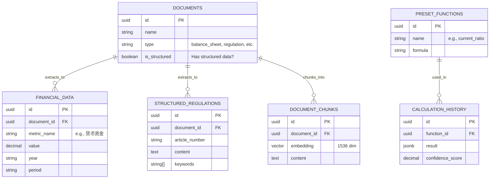
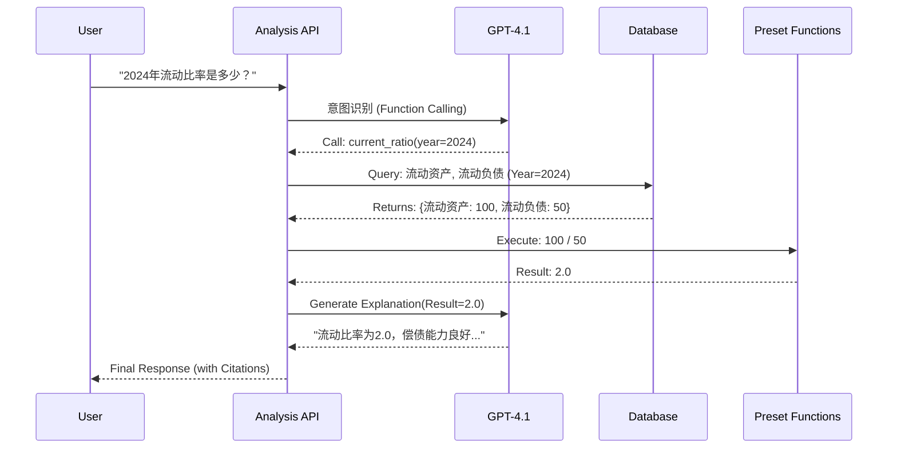
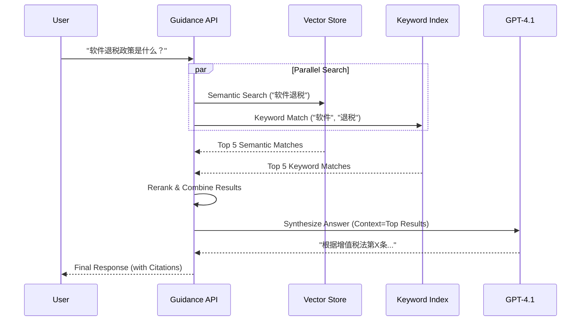

# 阶段 2：设计与架构文档

> **文档用途**: 记录特定版本的技术架构和设计决策。在阶段 2（设计）期间创建，作为实现的蓝图。
> 如果实现与原始计划有重大偏差，需要更新此文档。
>
> | 读者 | 更新频率 | 相关文档 |
> |------|----------|----------|
> | 开发者、AI 助手 | 架构变更时 | TRACK (实现日志), README (用户摘要) |

---

**项目**: Project Goodman 可靠性升级
**阶段**: V2 - 阶段 2 - 设计与架构
**日期**: 2025-11-12 (Refactored 2025-12-02)
**状态**: 已批准

---

## 目录

1. [架构概览](#架构概览)
2. [数据库架构设计](#数据库架构设计)
3. [API 交互设计](#api-交互设计)
4. [核心算法与逻辑](#核心算法与逻辑)
5. [UI/UX 设计理念](#uiux-设计理念)
6. [安全架构](#安全架构)

---

## 架构概览

### 高层架构图

```mermaid
graph TD
    User[用户] --> Frontend[前端 (Next.js + React 19)]
    
    subgraph Frontend
        Landing[智能首页]
        Extract[信息提取]
        Analysis[指标分析]
        Guidance[合规指导]
    end
    
    Frontend --> API[API 层 (Next.js API Routes)]
    
    subgraph API_Layer
        Orchestrator[LLM 编排层]
        Processor[确定性处理层]
    end
    
    API --> DB[(Supabase PostgreSQL)]
    API --> LLM[OpenAI GPT-4.1]
    
    subgraph Database
        Structured[结构化数据 (Tables)]
        Vector[向量存储 (pgvector)]
    end
    
    DB --> Structured
    DB --> Vector
```

### 关键架构原则

1. **关注点分离 (Separation of Concerns)**:
    * **LLM**: 负责意图识别、非结构化数据提取、自然语言生成。
    * **确定性代码**: 负责数学计算、逻辑验证、数据库查询。
    * *原则*: 永远不要让 LLM 做算术题。

2. **双重存储策略 (Dual-Store Strategy)**:
    * **结构化存储**: 用于精确查询（如"2024年资产负债率"）。
    * **向量存储**: 用于语义搜索（如"关于软件退税的规定"）。
    * *优势*: 结合了传统数据库的准确性和 AI 的灵活性。

3. **多维度置信度评分 (Confidence Gating)**:
    * 系统对每个 AI 生成的回答进行评分（0-1）。
    * 低于阈值的回答会被拦截或标记警告，防止幻觉误导用户。

---

## 数据库架构设计

> **注意**: 详细的 SQL Schema 定义请参考 `supabase/migrations/` 目录。

### 实体关系图 (ER Diagram)



### 核心表职责

| 表名 | 描述 | 存储策略 |
|------|------|----------|
| `documents` | 所有上传文件的元数据中心 | 结构化 |
| `financial_data` | 从财报中提取的原子财务指标（如"货币资金"） | 结构化 (精确匹配) |
| `structured_regulations` | 法规条款的结构化拆分，包含关键词索引 | 结构化 + 全文检索 |
| `document_chunks` | 文档的文本分块及其向量嵌入 | 向量 (语义检索) |
| `preset_functions` | 预定义的财务计算公式库 | 结构化 (只读配置) |
| `calculation_history` | 所有计算请求的审计日志 | 结构化 (追加写入) |

---

## API 交互设计

> **注意**: 详细的 API 实现请参考 `src/app/api/` 目录。

### 核心端点摘要

| 模块 | 方法 | 路径 | 描述 |
|------|------|------|------|
| **着陆页** | POST | `/api/landing-chat` | 智能路由，分析用户意图并推荐功能模块 |
| **信息提取** | POST | `/api/data-extract` | (演示) 提取文档信息，不保存 |
| **信息提取** | POST | `/api/admin/upload-database-document` | (管理员) 提取并保存到结构化数据库 |
| **指标分析** | POST | `/api/financial-analysis-v2` | 基于预设函数或动态工具计算财务指标 |
| **合规指导** | POST | `/api/guidance-chat-v2` | 结合法规库提供合规建议 |

### 交互时序图：财务指标计算



### 交互时序图：合规指导 (混合检索)



---

## 核心算法与逻辑

### 1. 预设函数库 (Preset Functions)
>
> **代码位置**: `src/lib/preset-functions.ts`

为了保证计算的**绝对准确性**，我们不依赖 LLM 进行数学运算。

* **机制**: 系统内置了 15+ 个标准财务公式（如 ROE, 资产负债率）。
* **流程**: LLM 仅负责提取参数，实际计算由 TypeScript 引擎执行 `expr-eval` 完成。
* **扩展性**: 新增公式只需在配置文件中添加定义，无需重新训练模型。

### 2. 混合检索 (Hybrid Search)
>
> **代码位置**: `supabase/migrations/*_add_database_functions.sql`

为了提高法规检索的召回率和准确率，我们采用混合策略：

* **向量检索 (50% 权重)**: 捕捉语义相关性（如 "钱" vs "资金"）。
* **关键词检索 (50% 权重)**: 捕捉精确术语（如 "第十三条"）。
* **结果**: 解决了纯向量检索在精确匹配特定法律条款时的弱点。

### 3. 提示词工程策略 (Prompt Engineering)
>
> **代码位置**: `src/lib/prompts/`

* **角色设定 (Role-Playing)**: 为每个模块设定特定专家角色（如"资深税务顾问"）。
* **思维链 (Chain-of-Thought)**: 强制 LLM 在回答前先输出思考过程（如"步骤1：识别用户意图..."）。
* **结构化输出**: 强制要求 JSON 格式输出，便于前端渲染和逻辑处理。

---

## UI/UX 设计理念

* **对话优先 (Chat-First)**: 所有功能模块均以对话框为核心交互区域。
* **渐进式披露 (Progressive Disclosure)**:
  * 初次加载仅显示核心功能。
  * 高级选项（如管理员模式）隐藏在"彩蛋"或特定路径中。
* **可追溯性 (Traceability)**:
  * 所有 AI 结论必须带有**引用源**（点击可查看原文档）。
  * 所有计算结果必须带有**计算步骤**（点击可查看公式和原始数据）。

---

## 安全架构

1. **管理员认证**:
    * 基于 `bcrypt` 的密码哈希验证。
    * 无状态 Session 管理。
    * 敏感操作（如写入数据库）必须携带 Admin Token。

2. **数据隔离**:
    * 用户上传的临时文档 (`is_temp=true`) 与系统知识库物理隔离。
    * API 层强制校验文档访问权限。

3. **输入防护**:
    * 所有 LLM 输入经过清洗，防止 Prompt Injection。
    * 所有数据库查询使用参数化查询，防止 SQL Injection。
